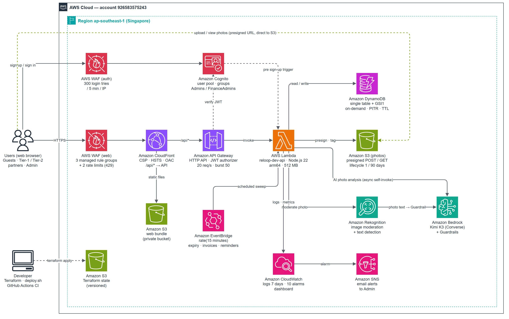

# RELOOP
## Chợ đồ điện tử cũ, hỏng có AI hỗ trợ, xây dựng serverless trên AWS

### 1. Tóm tắt điều hành
ReLoop là chợ trên web, nơi người dùng tại Việt Nam bán thiết bị điện tử cũ hoặc hỏng (điện thoại, laptop, màn hình, linh kiện) cho tiệm sửa chữa, người thu mua và đơn vị tái chế gần mình. Dự án do **AWSS3nt1n4L**, nhóm 5 người thuộc chương trình AWS First Cloud Journey (FCAJ) tại TP. Hồ Chí Minh, xây dựng trong 12 tuần thực tập (14/09–04/12/2026). Người bán tải ảnh lên, Amazon Bedrock tự điền sẵn thông tin tin đăng. Sau đó tin được gửi tới mọi đơn vị thu mua đã được duyệt có vùng phục vụ của chi nhánh (1–15 km) bao phủ vị trí người bán. Giao dịch chốt bằng báo giá của đơn vị thu mua hoặc bằng giá hai bên thỏa thuận trong chat. Ngày 08/11/2026, môi trường dev có 14 tài khoản, 12 tin đang mở của 7 người bán và khoảng 31.000 request API trong tháng đầu. Thiết kế serverless mở rộng được mà không phải làm lại kiến trúc: giới hạn Lambda chạy song song đã được duyệt tới 1.000. Các dịch vụ chính gồm CloudFront, AWS WAF, API Gateway, Lambda, DynamoDB, S3, Cognito, Rekognition, Bedrock, EventBridge, CloudWatch và SNS. Khách xem Chợ không cần tài khoản. Người đã đăng nhập được chat và mua. Chỉ đối tác được Admin duyệt mới được bán, và chỉ Admin cùng Admin tài chính được kiểm duyệt nội dung và xử lý hóa đơn.

#### Thành viên nhóm

| Thành viên | Vai trò |
|---|---|
| Kung Cẩm Thành | Trưởng nhóm (Team Lead) |
| Hoàng Quốc Việt | Trưởng kỹ thuật (Tech Lead) |
| Trần Hoàng Quốc Trung | Kỹ sư Backend |
| Nguyễn Duy Quang | Kỹ sư Frontend |
| Nguyễn Anh Kỳ | An ninh mạng / Tài liệu |

### 2. Tuyên bố vấn đề
#### Vấn đề hiện tại
Theo Global E-waste Monitor 2024 (UNITAR/ITU), năm 2022 thế giới thải ra 62 triệu tấn rác điện tử, nhưng chỉ 22,3% được thu gom và tái chế chính thức. Cũng theo báo cáo này, Việt Nam thải ra khoảng 516.000 tấn (≈5,3 kg mỗi người) năm 2022. Người có thiết bị cũ hoặc hỏng thường không biết ai nhận và thiết bị đáng giá bao nhiêu. Hiện họ đăng lên các trang rao vặt chung hoặc nhóm mạng xã hội, tự mô tả thiết bị, gọi từng tiệm, và nhiều khi không ai trả lời. Các chợ chung như Chợ Tốt hay Facebook Marketplace làm cho mọi loại hàng, nên không có:
- ghép tin với những tiệm có vùng phục vụ bao phủ người bán,
- giá dự kiến tính theo bảng giá của chính bên mua,
- hồ sơ uy tín ghi nhận bên mua giữ đúng báo giá.

Tiệm sửa chữa nhỏ gặp khoảng trống tương tự từ phía bên kia: không có kênh rẻ để nhận đúng loại thiết bị mình thu mua ở gần.

#### Giải pháp
ReLoop chạy toàn bộ luồng trên dịch vụ AWS được quản lý, không có máy chủ nào phải vận hành.
- **Nhận dữ liệu (ingest):** trình duyệt tải tối đa 6 ảnh mỗi tin (JPEG/PNG/WebP, tối đa 5 MB mỗi ảnh) thẳng lên Amazon S3 bằng presigned POST URL. Amazon Rekognition kiểm mọi ảnh xem có nội dung nhạy cảm không và đọc chữ trong ảnh. Chữ đó được đưa qua Amazon Bedrock Guardrails, nên các câu cố tình điều khiển AI (prompt injection) bị gắn cờ để Admin duyệt.
- **Xử lý:** một hàm AWS Lambda (Node.js 22, arm64) phục vụ 111 route API phía sau Amazon API Gateway. Hàm còn tự gọi chính nó kiểu bất đồng bộ cho các việc chậm:
  - AI phân tích ảnh bằng Kimi K3 trên Bedrock, khoảng 35 giây mỗi lần;
  - ghép tin với chi nhánh bên mua bằng geohash + Haversine.

  Amazon EventBridge gọi cùng hàm đó mỗi 15 phút để cho tin hết hạn, tự hoàn tất giao dịch sau 48 giờ, gửi nhắc việc và lập hóa đơn tháng.
- **Lưu trữ:** một bảng Amazon DynamoDB (PK/SK + 1 GSI) chứa mọi loại dữ liệu: người dùng, đối tác, chi nhánh, quy tắc giá, tin đăng, báo giá, giao dịch, chat, đánh giá, hóa đơn và nhật ký Admin. Mọi lệnh ghi đều có điều kiện, và các API liên quan tới tiền bắt buộc có `Idempotency-Key`. Quy tắc S3 lifecycle xóa ảnh chưa dùng sau 1 ngày và xóa mọi ảnh sau 90 ngày.
- **Giao diện:** ứng dụng React một trang, phục vụ từ bucket S3 riêng tư qua Amazon CloudFront. Gồm Chợ công khai, cổng đối tác (2 cấp) và cổng Admin.
- **Bảo mật:** Amazon Cognito lo đăng nhập, có group Admins / FinanceAdmins. API Gateway kiểm JWT trên mọi route riêng tư. Hai AWS WAF web ACL bảo vệ web: một trên CloudFront (bộ luật có sẵn + giới hạn tốc độ), một trên user pool Cognito (giới hạn số lần đăng nhập). Web áp Content-Security-Policy chặt, và mỗi quyền IAM chỉ cấp đúng phần code cần.

So với trang rao vặt chung, ReLoop có thêm: AI điền tin, ghép theo vùng phục vụ, giá dự kiến theo quy tắc, hoàn tất 2 bước (người bán xác nhận giá cuối, bên mua chấp nhận) và đánh giá hai chiều. ReLoop không xử lý thanh toán: hai bên trả tiền trực tiếp khi bàn giao.

#### Lợi ích và hoàn vốn đầu tư (ROI)
- **Bớt nhập tay:** AI gợi ý tiêu đề, loại, hãng, model và tình trạng từ tối đa 3 ảnh. Người bán chỉ cần xác nhận hoặc sửa. Đăng một tin mất khoảng 5 phút nếu nhập tay, dưới 1 phút nếu có AI (nhóm ước tính).
- **Ít tin bị bỏ ngỏ:** mỗi tin mới được tự ghép với mọi chi nhánh bên mua trong bán kính, tin trong 5 km được xếp trước.
- **Tin cậy:** state machine, ghi có điều kiện và việc nền idempotent giữ tin đăng, báo giá và giao dịch luôn nhất quán. Có 182 test tự động và một smoke test chạy trọn luồng trên AWS.
- **Giá trị học tập:** nhóm thực hành thiết kế DynamoDB một bảng, Lambda hướng sự kiện, Bedrock trả JSON có cấu trúc, IaC bằng Terraform, tinh chỉnh WAF và pentest tự động.
- **Chi phí:** khoảng **18,70 USD/tháng (224,40 USD/năm)** ở quy mô hiện tại (mục 6). Trong đó 17,00 USD là AWS WAF, nên nếu không dùng WAF thì nền tảng chỉ tốn khoảng 1,70 USD/tháng. Đến 28/02/2027, chi phí được trừ vào credit còn lại của tài khoản (197,14 USD ngày 08/11/2026).
- **Hoàn vốn:** doanh thu là 10.000đ mỗi giao dịch hoàn tất, người bán trả. Giả định 1 USD ≈ 26.000đ (tỷ giá xấp xỉ, tháng 11/2026), 18,70 USD ≈ 486.200đ. Vậy nền tảng hòa vốn ở **49 giao dịch hoàn tất mỗi tháng**, hoặc 5 giao dịch mỗi tháng nếu không dùng WAF.

### 3. Kiến trúc giải pháp
ReLoop hoàn toàn serverless, nằm trong một region (ap-southeast-1):
- Mọi truy cập từ trình duyệt đi qua AWS WAF và CloudFront. File tĩnh lấy từ bucket S3 riêng tư, còn `/api/*` được chuyển tới HTTP API kèm một header bí mật, nên gọi thẳng API Gateway sẽ bị từ chối.
- Một hàm Lambda chứa toàn bộ nghiệp vụ. Hàm gọi DynamoDB, S3, Rekognition và Bedrock qua các adapter nhỏ, nên cùng một code chạy được cả trên máy cá nhân bằng Node.js với bộ nhớ tạm.
- Đăng ký và đăng nhập đi thẳng từ trình duyệt tới Cognito, có WAF thứ hai bảo vệ.
- Log và số liệu nghiệp vụ đổ về CloudWatch; khi có cảnh báo, SNS gửi email cho Admin.
- Toàn bộ hạ tầng viết bằng Terraform, state lưu trong bucket S3 có versioning.

*File gốc sơ đồ: `static/images/2-Proposal/reloop-architecture.drawio` (sinh bằng `diagram/make_architecture.py`).*

#### Dịch vụ AWS sử dụng
- **Amazon CloudFront:** phục vụ web và chuyển `/api/*` tới API Gateway. Gắn header CSP, HSTS, X-Frame-Options và trả 404 thật khi thiếu file tĩnh.
- **AWS WAF:** 2 web ACL.
  - `reloop-dev-web` trên CloudFront: 3 bộ luật AWS managed + 2 giới hạn tốc độ trả 429. Giới hạn là 100 request/phút mỗi IP cho API công khai và 1.000 request/phút mỗi IP cho toàn bộ.
  - `reloop-dev-auth` trên Cognito: 300 lần đăng nhập / 5 phút mỗi IP, kèm chặn IP có tiếng xấu.
- **Amazon S3:** 3 bucket — bản build web (riêng tư, OAC), ảnh thiết bị (presigned POST/GET, lifecycle theo tag) và Terraform state (có versioning).
- **Amazon API Gateway (HTTP API):** kiểm JWT trên mọi route riêng tư; giới hạn 20 request/giây, burst 50.
- **AWS Lambda:** `reloop-dev-api`, Node.js 22 trên arm64 (Graviton), 512 MB. Chạy API, worker AI/ghép tin bất đồng bộ, job định kỳ và trigger pre sign-up của Cognito. Thời gian chạy trung bình 144 ms; giới hạn chạy song song 1.000.
- **Amazon DynamoDB:** một bảng on-demand với PK/SK và GSI1, bật PITR và TTL (thông báo tự xóa sau 90 ngày). Hiện có khoảng 5.600 bản ghi (2,4 MB).
- **Amazon Cognito:** user pool xác minh qua email, có group Admins, FinanceAdmins, Partners, Owners. Hiện có 14 người dùng.
- **Amazon Rekognition:** gắn nhãn kiểm duyệt cho mọi ảnh (từ chối ảnh nhạy cảm, ca nghi ngờ chuyển Admin) và đọc chữ trong ảnh.
- **Amazon Bedrock:** Kimi K3 qua Converse API có tool choice, trả JSON có cấu trúc. Guardrail (tier Standard) lọc đầu vào/đầu ra của AI và chữ đọc được trong ảnh. Mỗi người dùng tối đa 20 lượt phân tích/ngày.
- **Amazon EventBridge:** 1 rule chạy mỗi 15 phút để gọi job quét nền.
- **Amazon CloudWatch:** log giữ 7 ngày, số liệu nghiệp vụ tự định nghĩa, 1 dashboard và 10 alarm (Lambda lỗi/throttle, API 5xx, p95 > 2 giây, lỗi AI/job, chữ lạ trong ảnh, có khiếu nại mới).
- **Amazon SNS:** gửi email cảnh báo cho Admin.
- **AWS IAM:** một execution role chỉ có quyền trên bảng chính, prefix ảnh, đúng model Bedrock và Guardrail, Rekognition, tự gọi chính hàm và ghi log.
- **AWS Security Agent:** pentest hộp đen tự động trên web dev (3,63 task-hour ngày 08/11/2026).

#### Thiết kế thành phần
- **Phía người dùng (Edge / Client):** ứng dụng một trang React 18 + TypeScript (Vite), dùng Leaflet + OpenStreetMap để chọn vị trí. Khách xem Chợ. Sau khi đăng nhập, người dùng vào cổng đối tác (cấp 1: người bán lẻ, tối đa 3 tin đang mở; cấp 2: doanh nghiệp có chi nhánh, quy tắc giá và báo giá, tối đa 10 tin) hoặc cổng Admin.
- **Nhận dữ liệu (Ingestion):**
  1. `POST /uploads/presign` trả presigned POST hạn 5 phút, trình duyệt tải ảnh thẳng lên S3.
  2. `POST /uploads/moderate` chạy Rekognition và gắn tag `moderation=passed` cho ảnh.
  3. Khi tạo tin, ảnh được gắn tag `state=attached`, nên lifecycle giữ lại.
- **Xử lý (Processing):** router HTTP lo JWT claims, idempotency key và kiểm dữ liệu đầu vào. State machine cho Listing, Quote, Transaction chỉ cho phép chuyển trạng thái hợp lệ (ví dụ hủy giao dịch có hiệu lực sau 5 phút, hoàn tất tự chấp nhận sau 48 giờ). AI và ghép tin chạy bằng tự gọi bất đồng bộ. Bộ chạy job xếp việc theo "ngăn giờ" nên tìm việc đến hạn mà không phải quét bảng.
- **Lưu trữ (Storage):** mọi cách truy vấn được khai báo trong `backend/src/store/keys.ts`; code không bao giờ quét bảng. Bảng tin Chợ chia theo tháng, phân trang bằng cursor có kiểm định dạng. Tiền lưu bằng số nguyên VND.
- **Giao diện web (Web Interface):** Chợ công khai, chat theo từng tin (cập nhật mỗi 5 giây) có ra giá, khung giao dịch (hẹn bàn giao, chỉnh giá, xác nhận, khiếu nại) và đánh giá.
- **Quản lý người dùng (User Management):** đăng ký Cognito có xác minh email. Trigger pre sign-up chặn một hộp thư mở nhiều tài khoản bằng email bí danh (`ten+1@…`, Gmail có dấu chấm). Admin duyệt hồ sơ đối tác; Admin tài chính lập và xác nhận hóa đơn tháng. Hóa đơn quá hạn hơn 3 ngày thì người bán không đăng tin mới được; quá 7 ngày thì tài khoản bị khóa.
- **Giám sát (Monitoring):** log JSON có cấu trúc, metric filter cho sự kiện nghiệp vụ, dashboard `reloop-dev-overview`, alarm gửi qua SNS email, log WAF đổ về CloudWatch Logs đã che header authorization và cookie.

### 4. Triển khai kỹ thuật
#### Các giai đoạn triển khai
1. **Nghiên cứu & kiến trúc (28/09–09/10/2026):** chuyển bản đặc tả v1.0 (1.189 đoạn) thành 45 quyết định nghiệp vụ (QĐ-01 → QĐ-45), liệt kê cách truy vấn DynamoDB, chọn một Lambda sau HTTP API, viết Terraform đầu tiên (Cognito, API Gateway, Lambda, S3/CloudFront).
2. **Ước tính chi phí & tính khả thi (05/10–09/10/2026):**
   - bỏ nạp/rút tiền qua ngân hàng (chưa có API ngân hàng), chuyển sang trả tiền trực tiếp khi bàn giao;
   - chọn DynamoDB on-demand và Lambda arm64;
   - đặt mọi lời gọi AWS sau interface để cả nhóm code trên máy cá nhân mà không tốn tiền AWS.
3. **Phát triển & deploy lần đầu (05/10–23/10/2026):** hoàn thành luồng Chợ đầy đủ trên AWS (19/10), mô hình đối tác 2 cấp, báo giá, ra giá trong chat, giao dịch, đánh giá, thu phí, kiểm duyệt và smoke test trọn luồng `smoke-aws.py` (đạt ngày 22/10).
4. **Tinh chỉnh kiến trúc (26/10–06/11/2026):**
   - làm lại toàn bộ giao diện theo thiết kế của PO và thêm cổng Admin mới;
   - chuyển AI sang Kimi K3 trên Bedrock (28/10);
   - chạy 5 đợt QA (146 mục, 03/11);
   - nâng giới hạn Lambda chạy song song từ 10 lên 1.000;
   - gắn AWS WAF cho CloudFront và Cognito (06/11).
5. **Kiểm thử, gia cố & bàn giao (09/11–04/12/2026):**
   - pentest và sửa lỗi (tuần 09/11);
   - bật CSP chặn thật;
   - một đường deploy CI/CD duy nhất, IAM user riêng cho từng thành viên;
   - SES cho email, AWS Budgets, load test, môi trường production;
   - tài liệu cuối kỳ và demo.

#### Yêu cầu kỹ thuật
- **Phần mềm:** Node.js 22, TypeScript 5, React 18 + Vite 5, Leaflet, amazon-cognito-identity-js, AWS SDK v3, esbuild, Vitest; Python 3 cho smoke test trên AWS.
- **Infrastructure as Code:** Terraform ≥ 1.10 (AWS provider 6.x), state lưu trên S3; `infra/deploy.sh` (build → `terraform apply` → upload web → xóa cache CloudFront); AWS CLI ≥ 2.32.
- **CI:** GitHub Actions chạy typecheck, 182 test và build web cho mỗi pull request.
- **Phần cứng:** chỉ cần laptop của thành viên, không có thiết bị tại chỗ.
- **Kỹ năng:** mô hình DynamoDB một bảng, IAM quyền tối thiểu, thiết kế prompt và Guardrail cho Bedrock, tinh chỉnh luật WAF, React, viết test có bản giả (fake) cho dịch vụ AWS.

### 5. Lộ trình & Mốc triển khai

| Tuần | Thời gian | Kết quả bàn giao |
|---|---|---|
| Tuần 1 | 14/09–18/09 | Nền tảng AWS: bảo mật tài khoản, IAM, VPC, EC2; làm quen nhóm |
| Tuần 2 | 21/09–26/09 | Kiến thức serverless (S3, DynamoDB, Lambda, API Gateway); Buildrathon khai mạc, chọn dự án ReLoop (26/09) |
| Tuần 3 | 28/09–02/10 | Chuyển bản đặc tả v1.0 thành 45 quyết định nghiệp vụ (QĐ-01 → QĐ-45) và 58 điểm còn thiếu; repo + CI; chia việc trong nhóm |
| Tuần 4 | 05/10–09/10 | Kiến trúc và cách truy vấn DynamoDB (`keys.ts`); đăng nhập Cognito + ứng dụng React; chốt chi phí và tính khả thi |
| Tuần 5 | 12/10–16/10 | Tải ảnh lên S3, kiểm duyệt bằng Rekognition, AI phân tích tin đầu tiên (Amazon Nova Pro) |
| Tuần 6 | 19/10–24/10 | Môi trường dev bằng Terraform; luồng Chợ đầy đủ chạy trên AWS (19/10); smoke test đạt (22/10); job EventBridge; dashboard |
| Tuần 7 | 26/10–30/10 | Giao diện mới theo thiết kế PO (web công khai, cổng đối tác, cổng Admin); đọc chữ trong ảnh + Guardrails; AI chuyển sang Kimi K3 (28/10) |
| Tuần 8 | 02/11–06/11 | Ghép tin chạy nền; 5 đợt QA (146 mục, 03/11); load test → Lambda song song 1.000; AI tối đa 20 lượt/ngày; WAF cho CloudFront + Cognito (06/11) |
| Tuần 9 | 09/11–13/11 | Pentest bằng AWS Security Agent (7 phát hiện, không có mức cao); deploy bản sửa; bật CSP chặn thật; SES cho email; cảnh báo AWS Budgets 50% / 80% |
| Tuần 10 | 16/11–20/11 | Chạy lại load test sau khi sửa throttling (20/giây, burst 50); một đường deploy CI/CD; IAM user cho từng thành viên; môi trường production |
| Tuần 11 | 23/11–27/11 | Chuyển Terraform state; dọn tài nguyên thừa; rà soát chi phí |
| Tuần 12 | 30/11–04/12 | Báo cáo cuối kỳ, demo, tài liệu bàn giao |
| Sau ra mắt | 12/2026–02/2027 | Chạy dev/prod trong thời hạn credit (đến 28/02/2027); thu số liệu dùng thật cho AI và ghép tin |

### 6. Ước tính ngân sách
Ước tính dựa trên bảng giá công khai của AWS cho ap-southeast-1 (dùng [AWS Pricing Calculator](https://calculator.aws/) để tính lại). Bảng tính chi tiết từng dòng nằm ở [reloop-cost-estimate.csv](/files/2-proposal/reloop-cost-estimate.csv).

#### Chi phí hạ tầng
Region ap-southeast-1 (Singapore). Số liệu lấy từ Cost Explorer và CloudWatch thực tế từ 26/09 đến 08/11/2026: khoảng 31.000 request API và 14 người dùng.

| Dịch vụ | USD / tháng | Giả định |
|---|---|---|
| AWS WAF – web ACL CloudFront | 10,00 | 1 web ACL (5,00) + 5 rule (5 × 1,00) + 0,60 mỗi 1 triệu request |
| AWS WAF – web ACL Cognito | 7,00 | 1 web ACL (5,00) + 2 rule (2 × 1,00) |
| Amazon Bedrock (Kimi K3 + Guardrails) | 1,00 | Mức dùng tháng 10 (0,87 USD), tối đa 20 lượt/người/ngày |
| Amazon Rekognition | 0,30 | Kiểm duyệt + đọc chữ cho khoảng 70–100 ảnh/tháng |
| Amazon DynamoDB (on-demand) | 0,10 | Khoảng 5.600 bản ghi, 2,4 MB, bật PITR |
| Amazon API Gateway (HTTP API) | 0,10 | Khoảng 31.000 request/tháng |
| Amazon S3 | 0,05 | Bản build web + ảnh (lifecycle 1/90 ngày) + Terraform state |
| Khác (truyền dữ liệu, mục lẻ) | 0,15 | Dự phòng cho các mục nhỏ thấy trong tháng 10 |
| AWS Lambda | 0,00 | Khoảng 2.250 GB-s/tháng — Free Tier (1 triệu request + 400.000 GB-s) |
| Amazon CloudFront | 0,00 | Free Tier (1 TB + 10 triệu request/tháng) |
| Amazon Cognito | 0,00 | 14 người dùng — Free Tier tới 10.000 MAU |
| Amazon CloudWatch + SNS + EventBridge | 0,00 | 10 alarm, 1 dashboard, log 7 ngày, email cảnh báo, 1 lịch chạy — Free Tier |
| AWS Security Agent | 0,00 | Dùng thử miễn phí (400 task-hour/tháng); đã dùng 3,63 task-hour |
| **Tổng mỗi tháng** | **18,70** | |
| **Tổng 12 tháng** | **224,40** | |

- **Phần cứng một lần:** 0 USD.
- **Credit:** tài khoản đang ở gói AWS Free, còn 197,14 USD credit, hạn 28/02/2027. Số này đủ trả cho khoảng 3,7 tháng còn lại tới hạn (≈ 69 USD) mà không tốn tiền mặt.
- **Tùy chọn tiết kiệm:** tắt cả 2 WAF web ACL (`waf_enabled`, `cognito_waf_enabled`) thì chi phí còn khoảng 1,70 USD/tháng, nhưng mất giới hạn tốc độ và bộ luật có sẵn.
- *Giá tham khảo theo bảng giá AWS region ap-southeast-1 tháng 11/2026, có thể thay đổi. Các dòng tính theo mức dùng sẽ tăng theo lượng truy cập.*

### 7. Đánh giá rủi ro
#### Ma trận rủi ro

| Rủi ro | Mức ảnh hưởng | Xác suất |
|---|---|---|
| R1. Hai máy deploy code khác nhau lên cùng một Lambda (đã xảy ra ngày 28/10/2026) | Cao | Trung bình |
| R2. Hết credit hoặc phát sinh phí bất ngờ (tài khoản gói Free bị đóng khi dùng hết credit) | Cao | Thấp |
| R3. Lambda/API bị throttle khi tải tăng đột biến (load test: 80 request song song → 26% lỗi 5xx khi giới hạn là 10) | Trung bình | Trung bình |
| R4. AI nhận sai thiết bị hoặc bị chữ độc hại trong ảnh điều khiển | Trung bình | Trung bình |
| R5. Lỗ hổng bảo mật ở web hoặc API công khai | Cao | Thấp |
| R6. Hai bên chốt ngoài nền tảng để né phí | Trung bình | Cao |
| R7. Giới hạn email mặc định của Cognito (~50 email/ngày) chặn đăng ký giữa buổi demo | Trung bình | Trung bình |

#### Chiến lược giảm thiểu
- **R1:** chỉ một đường deploy (`deploy.sh` từ bản đã commit, chuyển dần sang CI), IAM user riêng cho từng thành viên, không dùng access key của root. Trước mỗi lần deploy, kiểm `LastModified` của Lambda đang chạy và CloudTrail.
- **R2:** mỗi tính năng tốn tiền được so với số credit còn lại trước khi bật, kèm giới hạn cứng (AI 20 lượt/ngày/người, pentest dừng ở 3,5 task-hour). Thêm cảnh báo AWS Budgets ở mức 50% / 80%.
- **R3:** đã nâng giới hạn Lambda song song lên 1.000; giới hạn của API Gateway (20/giây, burst 50) và luật tốc độ của WAF trả 429 kèm Retry-After thay vì báo lỗi.
- **R4:** AI chỉ gợi ý, người bán xác nhận từng trường; hệ thống lưu gợi ý của AI cạnh giá trị người bán chốt. Guardrails và Rekognition gắn cờ chữ đáng ngờ trong ảnh, và tin bị gắn cờ phải chờ Admin duyệt.
- **R5:** bộ luật WAF có sẵn, CSP chặt, JWT trên mọi route riêng tư, kiểm quyền sở hữu key ảnh, và pentest mỗi lần phát hành (lần gần nhất: 7 phát hiện, không có mức cao, bản sửa đã lên ngày 08/11/2026).
- **R6:** tính phí khi gỡ tin trong 72 giờ sau một giao dịch bị hủy, khiếu nại phí do Admin tài chính xử lý, và người vi phạm nhiều lần bị gắn cờ.
- **R7:** chuyển email của Cognito sang Amazon SES trước khi mở cho người dùng thử.

#### Kế hoạch dự phòng
- **Deploy hỏng:** deploy lại commit tốt gần nhất bằng `deploy.sh`. Terraform giữ nguyên phần còn lại, và `terraform plan` cho thấy đúng phần thay đổi trước khi áp.
- **Chi phí tăng vọt:** đặt `waf_enabled=false` / `cognito_waf_enabled=false` và hạ giới hạn AI mỗi ngày. Dừng job Security Agent bằng `stop-pentest-job`.
- **Bedrock không dùng được:** AI là tùy chọn, người bán tự điền form và tin vẫn đăng được.
- **WAF hoặc CSP chặn nhầm người dùng thật:** sửa luật/ngưỡng hoặc CSP trong `infra/waf.tf` / `infra/web.tf` rồi apply. Chỉ cần một lần cập nhật CloudFront, không phải phát hành code mới.
- **Sự cố dữ liệu:** khôi phục DynamoDB bằng PITR (tối đa 35 ngày). Người bán có thể tải lại ảnh.

### 8. Kết quả kỳ vọng
#### Cải tiến kỹ thuật
- Một chợ hoàn chỉnh, chạy được trên AWS: 111 route API, 3 cổng giao diện, 182 test tự động, smoke test trọn luồng đạt trên AWS.
- Hạ tầng dựng lại được hoàn toàn từ Terraform bằng một lệnh, khoảng 18,70 USD/tháng. Phần thay đổi theo lượng dùng (Lambda, DynamoDB, API Gateway, S3) dưới 1 USD/tháng ở lượng truy cập hiện tại.
- Mức bảo mật đo được: WAF ở cả 2 cửa vào, CSP chặt, pentest 7 phát hiện, không có mức cao, mọi mục sửa được đều đã sửa.
- Thời gian phản hồi: Lambda chạy trung bình 144 ms, có alarm khi p95 vượt 2 giây.

#### Giá trị lâu dài
- Mỗi tin đăng lưu gợi ý của AI cạnh giá trị người bán chốt. Dần dần đây là dữ liệu có nhãn để đánh giá hoặc tinh chỉnh khả năng nhận diện thiết bị.
- Thiết kế adapter (Table, ImageStore, Analyzer, AuthProvider) cho phép đổi hoặc thêm dịch vụ, như email SES, chat WebSocket hay API thanh toán ngân hàng, mà không đụng tới nghiệp vụ.
- Cùng bộ Terraform và script deploy có thể dựng môi trường production hoặc cho một thành phố khác. Cách ghép tin bằng geohash dùng được ở mọi nơi.
- Tiệm sửa chữa và đơn vị tái chế có thêm kênh nhận thiết bị cũ ổn định ở gần. Nhờ vậy nhiều thiết bị được dùng lại hoặc tái chế chính thức hơn, thay vì nằm trong nhà.
